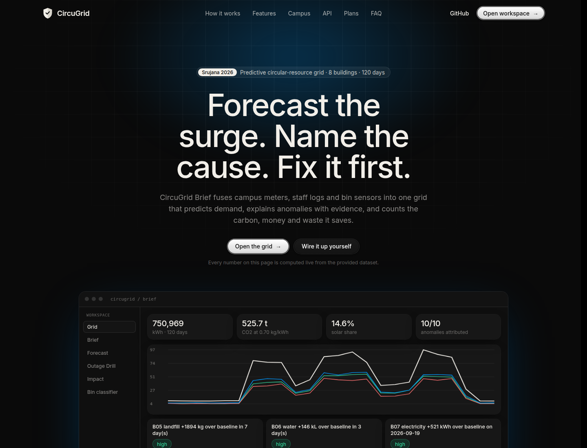
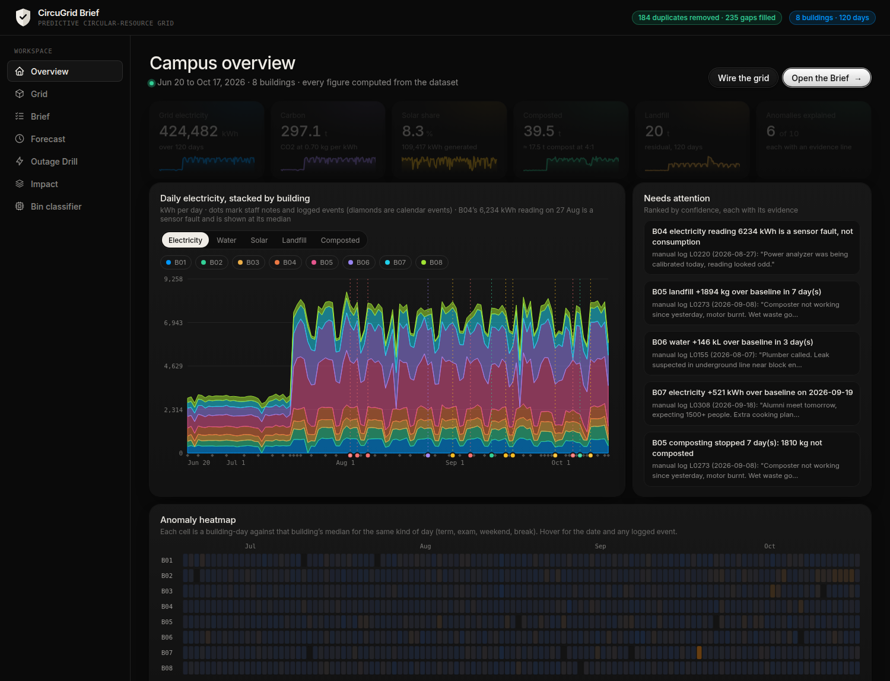
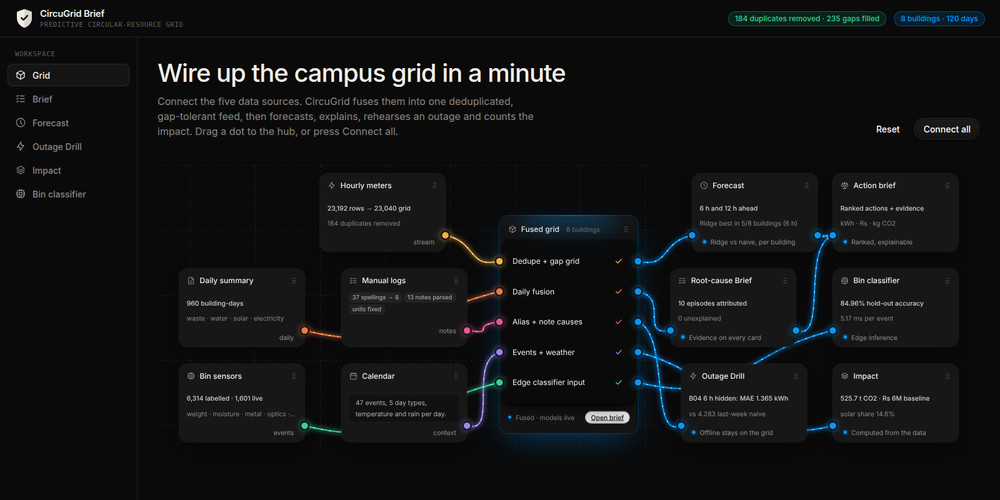
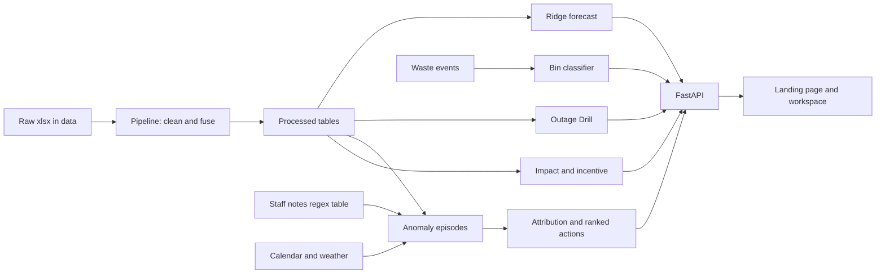

<div align="center">

# CircuGrid Brief

**A predictive circular-resource grid for multi-building campuses.**
Forecast the surge. Name the cause. Fix it first.


Built for **Srujana 2026 — “Prompt to Product: Prompt for the Planet”**



</div>

---

## Table of contents

1. [Overview](#overview)
2. [Why it matters](#why-it-matters)
3. [Features](#features)
4. [Results](#results)
5. [Screenshots](#screenshots)
6. [Architecture](#architecture)
7. [Data and cleaning](#data-and-cleaning)
8. [Models and methods](#models-and-methods)
9. [API reference](#api-reference)
10. [Quick start](#quick-start)
11. [Deployment](#deployment)
12. [Repository layout](#repository-layout)
13. [Against the problem statement](#against-the-problem-statement)
14. [Assumptions and limitations](#assumptions-and-limitations)
15. [Documentation](#documentation)
16. [Contributors](#contributors)

---

## Overview

Campus facilities teams audit buildings by hand, so a dead solar inverter, a broken composter or a surge in demand is usually noticed days late, and nobody can say *why* it happened. CircuGrid Brief fuses four noisy, asynchronous data sources from eight campus buildings into one grid that:

- **forecasts** electricity demand 6 and 12 hours ahead, scored against naive baselines,
- **explains** each anomaly by matching it to a staff note, a calendar event or the weather, and shows the evidence,
- **rehearses** a building going offline (the *Outage Drill*) and measures how well the grid fills the gap,
- **classifies** waste at the bin with a small, edge-sized model and routes food waste to a composter,
- **counts** the energy, carbon, cost, water and landfill impact, with every assumption shown.

Every number in the product is computed from the provided dataset. Nothing is hand-entered.

## Why it matters

Over the 120 days in the dataset (20 Jun – 17 Oct 2026):

| Finding | Value |
|---|---|
| Grid electricity | 750,969 kWh ≈ 525.7 t CO₂ at 0.70 kg/kWh ≈ Rs 6.0 M at Rs 8/kWh |
| Share used by the two hostels and the food court (B05–B07) | ~65% of electricity, ~95% of wet organic waste |
| Rooftop solar share of consumption | 14.6% (5 of 8 buildings have none) |
| Composted | 69.9 t, yet 26.6 t still went to landfill from the three composter buildings |
| Faults hidden in free-text staff notes | a water leak, a burnt-out composter motor, a solar inverter fault, a meter calibration |

The faults above never raised a flag on the meters. Joining the notes to the meter data is what makes them visible.

## Features

| Module | What it does | Where |
|---|---|---|
| **Fusion and cleaning** | Deduplicates hourly rows, reindexes to the full hourly grid, bridges short gaps, maps 37 building spellings to 8, normalises units, parses 13 free-text notes into causes, flags sensor faults | `src/pipeline.py` |
| **Forecast** | Ridge model per building, 6 h and 12 h ahead, time-ordered split, scored against two naive baselines | `src/forecast.py` |
| **Root-cause Brief** | Finds anomaly episodes, attributes each to a note, event, regime shift or weather, ranks actions with evidence lines | `src/insights.py` |
| **Outage Drill** | Hides real hours, estimates them from the visible hours and a day-type profile, reconnects and measures the error | `src/drill.py` |
| **Edge bin classifier** | Random forest on five sensors, six waste classes, held-out accuracy, per-event latency, compost-or-flag routing | `src/classifier.py` |
| **Impact and incentive** | kWh, rupees, CO₂, litres and kilograms per event; per-building baseline ranking | `src/impact.py`, `src/incentive.py` |
| **Web app** | Landing page, overview dashboard, wired-card grid, per-building drawer, forecast explorer, filters | `web/`, `src/api.py` |

### The web app

- **Landing page (`/`)** — dashboard hero, live statistics, the interactive wired grid, feature tabs, campus map, live API panel, data catalogue, constraints table, deployment plans, FAQ.
- **Workspace (`/app`)** — *Overview* (KPIs, stacked series with real event pins, anomaly heatmap, building cards, waste flow), *Grid*, *Brief*, *Forecast* (any building, horizon and window), *Outage Drill*, *Impact*, *Bin classifier*.
- Clicking a building card, a heatmap row or an attention item opens that building’s drawer: KPIs, electricity with its staff notes pinned, a live forecast chart, its flags and its notes.

## Results

All figures come from running the code in this repository on the supplied data.

| Component | Result | How it was measured |
|---|---|---|
| Bin classifier | **84.96%** accuracy, about 5 ms per event on a laptop CPU | Stratified 20% hold-out of the labelled file (n = 1,263). Just under the 85% target in the problem statement; five-fold CV on the training split gives about 84.6%, and random forest, extra trees and gradient boosting all land near 84.5% |
| Forecast, 6 h ahead | Ridge is the best of the three methods in **5 of 8** buildings; last-week naive wins B04, B06, B08 | WAPE on days after 18 Sep (never trained on) |
| Alumni-meet day (B07, 19 Sep) | “Same hour yesterday” (WAPE 0.369) beat ridge (0.416) | The model picks up the ramp and the residual names the surge; it does not predict a one-off event |
| Outage Drill, B04, 6 h window | Mean error **1.37 kWh** (4.2%) vs 4.28 for last-week naive and 14.2 for flat mean | Average over all 30 test days, the headline method never sees the hidden hours |
| Attribution | **10 of 10** episodes attributed, 0 unexplained | Notes, calendar events and weather |
| Data integrity | 184 duplicate hourly rows removed, 235 gap rows flagged, arrivals up to 12.1 h late | Pipeline statistics |

> The “best case once the daily summary arrives” bar in the drill is *not* better than the headline method here, because daily totals do not exactly match hourly sums. It is shown, labelled, and not used as the headline.

## Screenshots

| Overview dashboard | Wired grid |
|---|---|
|  |  |

## Architecture



One Python process serves both the JSON API and the static frontend. The cleaned data is rebuilt from the raw files on first start, and the slow models are warmed in a background thread so the first page load is quick. The front end is plain HTML, CSS and JavaScript with no build step.

## Data and cleaning

Seven files in `data/` (20 Jun – 17 Oct 2026, 8 buildings). They are **never modified**; cleaned output goes to `data/processed/` (git-ignored, rebuilt on demand).

| File | Shape | Role |
|---|---|---|
| `hourly_streams.xlsx` | 23,192 × 7 | Electricity, water, solar, footfall with arrival time |
| `daily_summary.xlsx` | 960 × 14 | Utilities and segregated waste per building-day |
| `manual_logs.xlsx` | 415 × 8 | Staff entries, mixed units, free-text notes |
| `calendar.xlsx` | 120 × 7 | Day type, events, weather |
| `waste_events_train.xlsx` | 6,314 × 10 | Labelled bin events |
| `waste_events_test.xlsx` | 1,601 × 9 | Unlabelled bin events |
| `buildings.xlsx` | 8 × 10 | Type, area, solar capacity, composter flag |

Cleaning steps and why:

- **Dedupe** hourly rows on (timestamp, building), keeping the latest arrival.
- **Reindex** to all 2,880 hours × 8 buildings so gaps are explicit and offline buildings are never dropped.
- **Alias map** for 37 spellings (“BH”, “Girls hostle”, “FC”…) to 8 buildings; **unit conversion** (units→kWh, kL→L, bags→kg at 8 kg) and a plausibility ceiling that rejects unit errors.
- **Notes → causes** through a regex table (leak, composter, inverter, calibration, meter fault, AC left on, event).
- **Sensor-fault flag** by robust z-score; the 6,234 kWh reading at B04 on 27 Aug is linked to its “power analyzer being calibrated” note and is never counted as consumption or savings.

Known gaps: null daily values are left as missing rather than invented; the numeric manual meter readings are cleaned and agree with the meter (median ratio 0.99) but are not yet used as a gap-filler.

## Models and methods

- **Forecast** — `Ridge` on hour-of-day, day type, weather, current load and footfall, same hour last week and yesterday; one model per building and horizon. Train on target times before 18 Sep, score on or after. Metrics: MAE and WAPE vs *same hour last week* and *same hour yesterday*. A gradient-boosting fit is timed for the accuracy-versus-compute comparison.
- **Anomaly episodes** — per building and stream, a robust z-score against the median of days in the same regime (working, exam, weekend, break); consecutive flagged days merge into one episode.
- **Attribution (ordered)** — compatible same-building note within ±1 day → calendar event → regime shift → heavy rain → unexplained. Solar skips events and regimes because only weather plausibly explains it.
- **Outage Drill** — day-type hourly profile built from training days only, scaled to the visible hours of the same day. Baselines: flat visible mean, same hours last week, unscaled profile.
- **Classifier** — median imputation then a 100-tree random forest on weight, moisture, metal signal, transparency and acoustic hardness. Predictions for the unlabelled file are written to `data/processed/waste_events_test_predictions.csv`; no accuracy is claimed on it.
- **Impact** — constants from the data guide: 0.70 kg CO₂/kWh, Rs 8/kWh, 0.85 kWh per 1,000 L, 4:1 compost ratio. Event figures are *avoidable if caught* scenarios, not measured outcomes.

## API reference

Base URL `http://localhost:8000`. Responses are JSON.

| Method | Path | Returns |
|---|---|---|
| GET | `/api/health` | Liveness and whether processed data exists |
| GET | `/api/stats` | Pipeline statistics (duplicates, gaps, aliases, notes) |
| GET | `/api/brief` | Ranked anomaly cards with cause, evidence, action, impact |
| GET | `/api/forecast` | Metrics for every building, horizon and window, plus the B07 alumni-meet series |
| GET | `/api/forecast/{building}?horizon=6\|12` | Test-period hourly series: actual, ridge, both naive baselines |
| POST | `/api/drill` | `{building_id, start, hours}` → hidden hours, estimates and errors vs baselines |
| GET | `/api/impact` | Campus baseline, attributed events, assumptions |
| GET | `/api/incentive` | Baseline-relative ranking per occupant |
| GET | `/api/classifier` | Accuracy, per-class metrics, confusion matrix, latency, routing |
| GET | `/api/buildings` | Per-building totals and metadata |
| GET | `/api/timeseries` | Daily series per building with staff notes and calendar events |

```bash
curl http://localhost:8000/api/brief
curl -X POST http://localhost:8000/api/drill \
  -H "content-type: application/json" \
  -d '{"building_id":"B04","start":"2026-10-08 10:00","hours":6}'
```

## Quick start

Requires Python 3.11 or newer. No API keys are needed.

```bash
git clone https://github.com/HARDIKSINGH150206/p2p.git
cd p2p
python3 -m venv .venv && source .venv/bin/activate
pip install -r requirements.txt
python -m src.pipeline            # optional: builds data/processed (also runs on first start)
uvicorn src.api:app --port 8000
```

Open <http://localhost:8000> for the landing page and <http://localhost:8000/app> for the workspace. On first load the models take a few seconds to warm; after that responses are cached.

Handy URL options: `?demo=1` connects the wired grid automatically (useful when recording), and `?flat` skips the hero tilt.

## Deployment

One process serves the API and the frontend.

- **Docker** — `docker build -t circugrid . && docker run -p 8000:8000 circugrid`
- **Render** — create a Web Service from this repo; `render.yaml` selects the Dockerfile and `/api/health` as the health check.
- **Railway / Fly / Heroku-style** — the `Procfile` starts `uvicorn src.api:app` on `$PORT`.

## Repository layout

```
├── src/
│   ├── pipeline.py      cleaning and fusion, writes data/processed
│   ├── forecast.py      ridge forecast, baselines, per-building series
│   ├── insights.py      anomaly episodes, attribution, action cards
│   ├── drill.py         Outage Drill and its benchmark
│   ├── classifier.py    edge bin classifier and routing
│   ├── impact.py        impact figures and assumptions
│   ├── incentive.py     baseline-relative ranking
│   └── api.py           FastAPI app and static hosting
├── web/                 landing page, workspace, shared graph (no build step)
├── data/                raw xlsx (read-only); data/processed is generated
├── Data_cleaning/       separate exploratory cleaning scripts and EDA
├── docs/                PRD, architecture, data notes, ideation record, prompt workbook
├── prompts/             ideator and evaluator prompts used to choose the idea
├── Dockerfile · Procfile · render.yaml · requirements.txt
```

## Against the problem statement

Problem: *Predictive Circular-Resource Grid for a Multi-Building Campus* (`PROBLEM.md`).

| Constraint | Status | Notes |
|---|---|---|
| Multi-source fusion under noise | Partly | Hourly, daily, notes and calendar fused; offline buildings kept. Manual numeric readings not yet fused |
| Edge classification, 5+ classes, >85%, <2 s | Partly | 6 classes, 84.96% (just under), ~5 ms per event; not run on edge hardware |
| Forecast 6–12 h ahead | Built | Ridge at 6 h and 12 h vs two baselines; best in 5 of 8 buildings at 6 h |
| Intermittent connectivity and integrity | Partly | Dedup, ordering by arrival, explicit gaps, Outage Drill on recorded data; no live buffering hardware |
| Root-cause attribution with ranked actions | Built | 10 of 10 episodes attributed, each with evidence |
| Behavioural and economic incentive loop | Partly | Baseline ranking only; pilot design written, not run |
| Cost and scale envelope | Design only | Rs 12,000 per building planning assumption and a four-point scale argument; not load-tested |
| Failure-mode awareness | Built | Sensor fault and incentive gaming / model drift, each with a mitigation |

## Assumptions and limitations

- **Synthetic data.** The dataset is a hackathon benchmark with injected faults. Results show the method works, not field performance.
- **Hardware budget** of Rs 12,000 per building (ESP32 and meter Rs 3,500, bin-sensor kit Rs 3,000, Raspberry-Pi-class box Rs 5,000, misc Rs 500) is a planning assumption, not a quote. There is no camera; the classifier uses the five sensor features supplied.
- **Forecast** is close to persistence at 6 h and does not beat a naive baseline everywhere. Its main job is a calibrated baseline that makes surges and faults visible.
- **Attribution** rests on about 13 usable notes plus the calendar, so most flags on other data would read “unexplained”.
- **Incentives** compare each building with its own baseline. No behaviour change is measured or claimed.
- **Totals** for electricity and the B04 share include the flagged 6,234 kWh sensor-fault reading; charts show it at the building median and say so.
- No authentication, no persistence beyond files, and no load testing.

## Documentation

| Document | Contents |
|---|---|
| [`docs/PRD.md`](docs/PRD.md) | Product requirements and feature status |
| [`docs/ARCHITECTURE_AND_DATAFLOW.md`](docs/ARCHITECTURE_AND_DATAFLOW.md) | Components, flow diagrams, scalability |
| [`docs/DATA_NOTES.md`](docs/DATA_NOTES.md) | Data profile, quality issues, insights |
| [`docs/DEVELOPMENT.md`](docs/DEVELOPMENT.md) | Stack, setup, methods |
| [`docs/ideation/FINAL.md`](docs/ideation/FINAL.md) | Idea selection through an ideator-evaluator loop (v1 7.2 → v2 8.0 → v3 8.3) |
| [`docs/PROMPT_WORKBOOK.md`](docs/PROMPT_WORKBOOK.md) | Prompts used to build the project |
| [`docs/PROBLEM_STATEMENT_AND_CONSTRAINTS.md`](docs/PROBLEM_STATEMENT_AND_CONSTRAINTS.md) | The problem statement |

## Contributors

- **Hardik Singh** — product, ML and backend, frontend, documentation
- **NYN-05** — exploratory data-integrity analysis and cleaning scripts (`Data_cleaning/`)

Built with Claude Code as the AI pair-programmer; prompts and iterations are logged in the prompt workbook.
