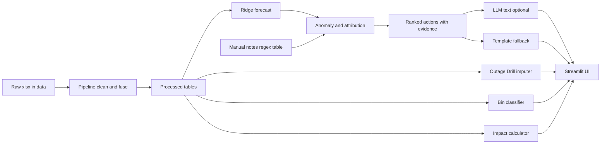
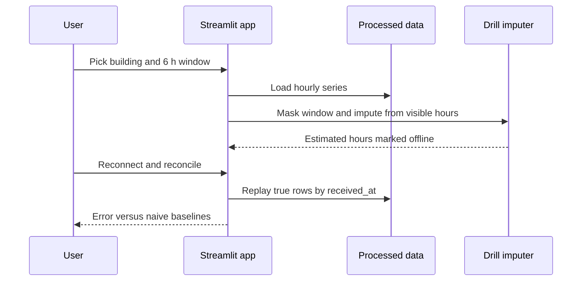

# Architecture & Dataflow — CircuGrid Brief
One-line: pandas/scikit-learn pipeline behind a Streamlit UI, optional LLM text layer. All components 📋 Planned.
Last updated: 12:15 IST

## Components
- Pipeline (`src/pipeline.py`): load, dedupe, reindex, alias/unit/note normalisation → `data/processed/`.
- Models (`src/models.py`): ridge forecast, anomaly threshold, Outage Drill imputer, bin classifier.
- Insights (`src/insights.py`): attribution, ranked actions with evidence, impact formulas.
- UI (`app.py`): Brief, B07 card, Outage Drill, Impact, Bin panel.
- LLM (optional): turns evidence into 2-sentence brief; fallback templates.

## Dataflow
| Stage | Input | Transformation | Output | File/function |
|---|---|---|---|---|
| Clean | hourly_streams, manual_logs | dedupe, reindex, alias, units | processed parquet/csv | 📋 src/pipeline.py |
| Fuse | hourly, daily, calendar, notes | join on building + time | fused tables | 📋 src/pipeline.py |
| Forecast | fused hourly | ridge 6/12 h vs naive | forecasts + metrics | 📋 src/models.py |
| Attribute | residuals, notes, calendar | ordered rules | causes + actions | 📋 src/insights.py |
| Drill | hourly | mask, impute, replay | error table | 📋 src/models.py |
| Classify | waste_events | tree/RF | predictions CSV + metrics | 📋 src/models.py |
| Present | all | charts, cards | UI | 📋 app.py |

## AI: runtime vs build time
- Runtime: scikit-learn models (local); optional Claude call for brief wording only.
- Build time: Claude Code writes code/docs; a separate ideator and evaluator subagent pair chose the idea (docs/ideation/). Not part of the shipped product.

## Scalability (design argument, untested)
1. Alias table filled at onboarding, unmatched names queued for review.
2. One small ridge per building; cold start uses the day-type profile until ~2 weeks of data.
3. Late-arrival buffer replay per gateway by received_at, bounded window.
4. Only Brief rows go to the central service; raw streams stay at the edge.
