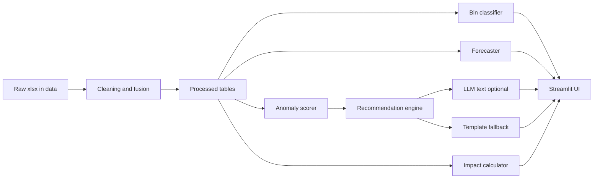
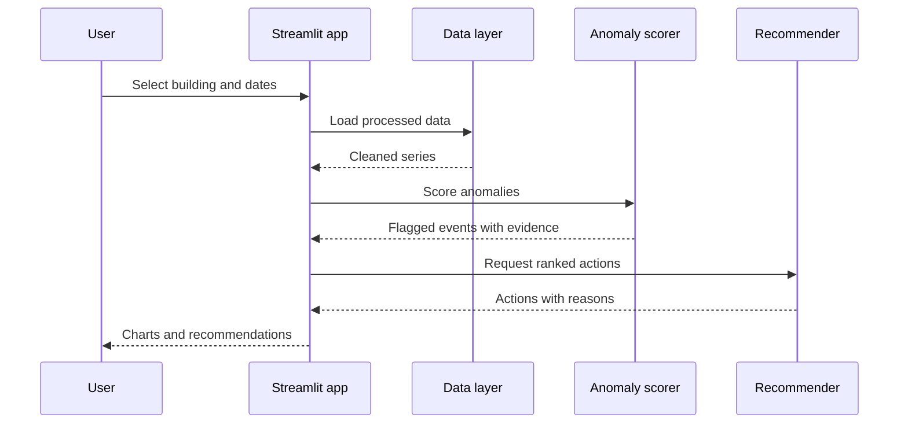

# Architecture & Dataflow
One-line: a pandas/scikit-learn pipeline behind a Streamlit UI with an optional LLM text layer. All components below are 📋 Planned.
Last updated: 11:30 IST

## Components
- Data layer: loads raw xlsx, cleans/fuses into `data/processed/`.
- Processing: dedup, gap detection, unit/name normalisation, feature building.
- Models: bin classifier, forecaster, anomaly scorer (CPU-only, small).
- AI/LLM (optional): turns structured findings into recommendation text; template fallback.
- UI: Streamlit tabs (Live Grid, Smart Bin, Forecast, Root-Cause, Impact).

## Dataflow
| Stage | Input | Transformation | Output | File/function |
|---|---|---|---|---|
| Ingest | data/*.xlsx | read | DataFrames | 📋 pipeline.py |
| Clean | hourly, manual_logs | dedup, order, unit/name fix | clean tables | 📋 pipeline.py |
| Fuse | hourly, daily, logs, calendar | join on building and time, flag gaps | fused table | 📋 pipeline.py |
| Classify | bin events | RF/tree predict | class per event | 📋 models.py |
| Forecast | fused hourly | lag features → model | 6–12 h forecast | 📋 models.py |
| Explain | anomalies, logs, events | rule-based attribution | ranked actions | 📋 insights.py |
| Present | all above | charts, KPIs | UI | 📋 app.py |

## AI: runtime vs build time
- Runtime: scikit-learn models (classify, forecast, anomaly); optional LLM for recommendation wording only. Works offline.
- Build time: Claude Code wrote the code and docs (see PROMPT_WORKBOOK.md). Not part of the shipped product.

## Scalability (design argument, not yet tested)
- Models are per-building features on small tables, so adding buildings means adding rows keyed by building_id, not new code.
- Each building buffers locally and syncs by (timestamp, building_id) key, so late or duplicate data is merged idempotently; same logic as our dedup step.
- Classifier is a small tree model; inference cost per event is tiny (measured value TBD).
- Beyond one campus: swap xlsx for a database/time-series store and run the same pipeline per campus (Planned, not built).
